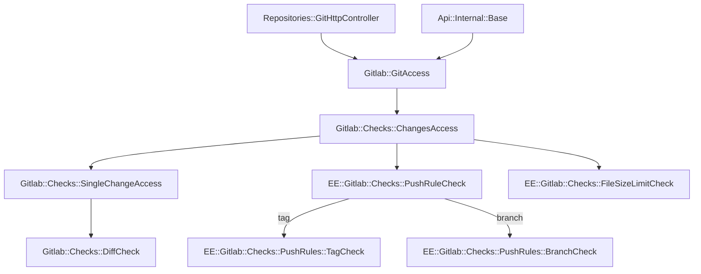

# Source Code: Push Rules

Push rules are pre-receive Git hooks that enforce commit and branch policies before changes are accepted. All push rule features require Premium+ license and are implemented in the `ee/` directory.

> **📅 Maintenance Note**: Sections marked with 📅 contain time-sensitive information (team contacts, active issues, roadmap, architecture docs). These should be reviewed periodically. Last reviewed: **2026-05-23**.

## When to Use This Skill

Use this skill when:
- Implementing or debugging push rule validation logic
- Working on commit message, author email, or branch name regex patterns
- Implementing secret file blocking (`prevent_secrets`)
- Working on commit signature requirements (`reject_unsigned_commits`)
- Implementing verified committer checks (`commit_committer_check`)
- Debugging why a push is being rejected
- Working on group or organization-level push rule inheritance

## Features Covered

| # | Feature | Tier | Description |
|---|---------|------|-------------|
| 9 | Push rules | Premium+ | Regex patterns for commits, branches, files, authors |
| 10 | Block secret file push | Premium+ | Prevent pushing files with known secret patterns |
| 14 | Reject unsigned commits | Premium+ | Require GPG/SSH signed commits |
| 15 | Verified committer | Premium+ | Require committer email to match GitLab user |

## Key Codebase Areas

### Models

| File | Purpose |
|------|---------|
| `ee/app/models/push_rule.rb` | Main model for project-level push rules |
| `ee/app/models/group_push_rule.rb` | Group-level push rules (inheritable) |
| `ee/app/models/organization_push_rule.rb` | Organization-level push rules (global/admin) |
| `ee/app/models/project_push_rule.rb` | Newer project push rule model |
| `ee/app/models/concerns/push_ruleable.rb` | **Core concern** with all validation logic |

### Services

| File | Purpose |
|------|---------|
| `ee/app/services/push_rules/base_service.rb` | Base service for push rule operations |
| `ee/app/services/push_rules/create_or_update_service.rb` | Create/update push rules |
| `ee/app/services/push_rules/create_predefined_rule_service.rb` | Create from templates (inheritance) |

### Controllers

| File | Purpose |
|------|---------|
| `ee/app/controllers/admin/push_rules_controller.rb` | Global/organization-level administration |
| `ee/app/controllers/groups/push_rules_controller.rb` | Group-level settings |
| `ee/app/controllers/projects/push_rules_controller.rb` | Project-level settings |

### Check Classes (Validation Logic)

| File | Purpose |
|------|---------|
| `ee/lib/ee/gitlab/checks/push_rule_check.rb` | **Main entry point** - orchestrates tag/branch checks |
| `ee/lib/ee/gitlab/checks/push_rules/branch_check.rb` | Branch name regex, triggers commit checks |
| `ee/lib/ee/gitlab/checks/push_rules/commit_check.rb` | **Core commit validation** - message, author, signatures |
| `ee/lib/ee/gitlab/checks/push_rules/tag_check.rb` | Tag deletion rules |
| `ee/lib/ee/gitlab/checks/diff_check.rb` | File path validations (secrets, filename regex) |
| `ee/lib/ee/gitlab/checks/file_size_limit_check.rb` | Max file size enforcement |

### Finders

| File | Purpose |
|------|---------|
| `ee/app/finders/push_rule_finder.rb` | Find global push rule |
| `ee/app/finders/group_push_rule_finder.rb` | Find group push rule |
| `ee/app/finders/project_push_rule_finder.rb` | Find project push rule |

### GraphQL

| File | Purpose |
|------|---------|
| `ee/app/graphql/types/push_rules_type.rb` | GraphQL type exposing all push rule fields |

## Push Rule Attributes

### Regex Fields (max 511 chars)

| Attribute | Purpose |
|-----------|---------|
| `commit_message_regex` | Commit message must match |
| `commit_message_negative_regex` | Commit message must NOT match (max 2047 chars) |
| `author_email_regex` | Author email must match |
| `branch_name_regex` | Branch name must match |
| `file_name_regex` | Block files matching pattern |

### Boolean Flags

| Attribute | Purpose | License Feature |
|-----------|---------|-----------------|
| `deny_delete_tag` | Prevent tag deletion | - |
| `member_check` | Require author to be project member | - |
| `prevent_secrets` | Block known secret file patterns | - |
| `reject_unsigned_commits` | Require GPG/SSH signatures | `:reject_unsigned_commits` |
| `commit_committer_check` | Committer email must be verified | `:commit_committer_check` |
| `commit_committer_name_check` | Committer name must match | `:commit_committer_name_check` |
| `reject_non_dco_commits` | Require DCO sign-off | `:reject_non_dco_commits` |

### Other

| Attribute | Purpose |
|-----------|---------|
| `max_file_size` | Maximum file size in MB |

## Test Locations

### Model Specs

| File | Coverage |
|------|----------|
| `ee/spec/models/push_rule_spec.rb` | Push rule model |
| `ee/spec/models/group_push_rule_spec.rb` | Group push rule |
| `ee/spec/models/concerns/push_ruleable_spec.rb` | Core validation logic |

### Check Specs

| File | Coverage |
|------|----------|
| `ee/spec/lib/ee/gitlab/checks/push_rule_check_spec.rb` | Main check orchestration |
| `ee/spec/lib/ee/gitlab/checks/push_rules/commit_check_spec.rb` | Commit validation |
| `ee/spec/lib/ee/gitlab/checks/push_rules/branch_check_spec.rb` | Branch validation |
| `ee/spec/lib/ee/gitlab/checks/push_rules/tag_check_spec.rb` | Tag validation |

### Service Specs

| File | Coverage |
|------|----------|
| `ee/spec/services/push_rules/create_or_update_service_spec.rb` | CRUD operations |

### Factories

| File | Purpose |
|------|---------|
| `ee/spec/factories/push_rules.rb` | Push rule factory |
| `ee/spec/factories/group_push_rules.rb` | Group push rule factory |

## Documentation

| Path | Content |
|------|---------|
| [`doc/user/project/repository/push_rules.md`](https://docs.gitlab.com/ee/user/project/repository/push_rules.html) | User documentation |
| [`doc/development/push_rules/_index.md`](https://docs.gitlab.com/ee/development/push_rules/) | Development guidelines |
| [`doc/api/project_push_rules.md`](https://docs.gitlab.com/ee/api/project_push_rules.html) | Project API |
| [`doc/api/group_push_rules.md`](https://docs.gitlab.com/ee/api/group_push_rules.html) | Group API |

## Common Patterns

### Push Rule Check Flow

```
Git Push (SSH/HTTP)
    → Gitlab::GitAccess
    → Gitlab::Checks::ChangesAccess
    → EE::Gitlab::Checks::PushRuleCheck
       ├── [tag ref] → TagCheck (deny_delete_tag)
       └── [branch ref] → BranchCheck
                            └── CommitCheck (message, author, signatures)
    → Gitlab::Checks::SingleChangeAccess
       └── DiffCheck (file_name_regex, prevent_secrets)
    → EE::Gitlab::Checks::FileSizeLimitCheck
```

**Key insight**: `PushRuleCheck` runs tag OR branch checks (not both). The `parallel_push_checks` feature flag enables parallel execution.

### PushRuleable Concern

The `PushRuleable` concern contains all validation methods:

```ruby
# Commit signature validation
def commit_signature_allowed?(commit)
  return true unless available?(:reject_unsigned_commits)
  return true unless reject_unsigned_commits
  commit.has_signature?
end

# Committer email verification
def committer_allowed?(committer_email, current_user)
  return true unless available?(:commit_committer_check)
  return true unless commit_committer_check
  current_user.verified_email?(committer_email)
end

# DCO (Developer Certificate of Origin) check
DCO_COMMIT_REGEX = 'Signed-off-by:.+<.+@.+>'
def non_dco_commit_allowed?(message)
  return true unless available?(:reject_non_dco_commits)
  return true unless reject_non_dco_commits
  data_match?(message, DCO_COMMIT_REGEX)
end
```

**Key insight**: Each check first verifies the feature is available (license), then checks if enabled.

### Secret Files Denylist

Location: `ee/lib/gitlab/checks/files_denylist.yml`

Blocks by default when `prevent_secrets` is enabled:
- AWS credentials files
- SSH private keys (RSA, DSA, ED25519, ECDSA, etc.)
- `.pem`, `.key` files
- Shell history files (`*_history`)

```ruby
def filename_denylisted?(file_path)
  regex_list = []
  regex_list.concat(FILES_DENYLIST) if prevent_secrets
  regex_list << file_name_regex if file_name_regex
  regex_list.find { |regex| data_match?(file_path, regex) }
end
```

### Web Push Bypass

Some checks can be bypassed for web-based commits:

```ruby
# In base_checker.rb
def updated_from_web?
  protocol == 'web'
end

# In base_single_checker.rb
def signed_by_gitlab?
  # Checks if commit was created by GitLab system (Web IDE)
end
```

**Key insight**: The `reject_unsigned_commits_by_gitlab` feature flag controls whether Web IDE commits are rejected.

## EE vs CE

### All Features are Premium+ (EE)

Push rules are entirely in `ee/` directory. There is no CE implementation.

### Feature Availability Checks

```ruby
# Check if push rules are available
project.feature_available?(:push_rules)

# Check specific features
project.feature_available?(:reject_unsigned_commits)
project.feature_available?(:commit_committer_check)
project.feature_available?(:commit_committer_name_check)
project.feature_available?(:reject_non_dco_commits)
```

### Inheritance Hierarchy

Push rules can be set at multiple levels:
1. **Organization** (global default)
2. **Group** (inherits from org, overrides for group)
3. **Project** (inherits from group, overrides for project)

## API Endpoints

### REST API - Project Push Rules

| Method | Endpoint | Purpose |
|--------|----------|---------|
| GET | `/api/v4/projects/:id/push_rule` | Get project push rule |
| POST | `/api/v4/projects/:id/push_rule` | Create project push rule |
| PUT | `/api/v4/projects/:id/push_rule` | Update project push rule |
| DELETE | `/api/v4/projects/:id/push_rule` | Delete project push rule |

### REST API - Group Push Rules

| Method | Endpoint | Purpose |
|--------|----------|---------|
| GET | `/api/v4/groups/:id/push_rule` | Get group push rule |
| POST | `/api/v4/groups/:id/push_rule` | Create group push rule |
| PUT | `/api/v4/groups/:id/push_rule` | Update group push rule |
| DELETE | `/api/v4/groups/:id/push_rule` | Delete group push rule |

### GraphQL

```graphql
query {
  project(fullPath: "group/project") {
    pushRules {
      commitMessageRegex
      branchNameRegex
      authorEmailRegex
      fileNameRegex
      preventSecrets
      rejectUnsignedCommits
      commitCommitterCheck
      maxFileSize
    }
  }
}
```

## Testing Guidelines

### Running Tests

```bash
# Model specs
bin/rspec ee/spec/models/push_rule_spec.rb
bin/rspec ee/spec/models/concerns/push_ruleable_spec.rb

# Check specs
bin/rspec ee/spec/lib/ee/gitlab/checks/push_rules/

# Service specs
bin/rspec ee/spec/services/push_rules/

# API specs
bin/rspec ee/spec/requests/api/project_push_rule_spec.rb
bin/rspec ee/spec/requests/api/group_push_rule_spec.rb
```

### Test Factories

```ruby
# Basic push rule
create(:push_rule, project: project)

# With specific settings
create(:push_rule,
  project: project,
  commit_message_regex: 'JIRA-\d+',
  prevent_secrets: true,
  reject_unsigned_commits: true
)

# Group push rule
create(:group_push_rule, group: group)
```

### Common Test Scenarios

1. **Commit message validation**: Test regex matching and negative regex
2. **Author email validation**: Test email patterns
3. **Branch name validation**: Test branch naming conventions
4. **Secret file blocking**: Test denylist patterns
5. **Signature requirements**: Test GPG/SSH signature checks
6. **Committer verification**: Test email verification
7. **Inheritance**: Test group → project inheritance

## Troubleshooting

### "Push rejected: commit message doesn't match pattern"

1. **Check the regex:**
   ```ruby
   project.push_rule.commit_message_regex
   project.push_rule.commit_message_negative_regex
   ```

2. **Test the pattern:**
   ```ruby
   message = "Your commit message"
   regex = project.push_rule.commit_message_regex
   message.match?(Regexp.new(regex))
   ```

### "Push rejected: author email doesn't match"

1. **Check author email regex:**
   ```ruby
   project.push_rule.author_email_regex
   ```

2. **Verify user's email:**
   ```ruby
   user.email
   user.emails.pluck(:email)
   ```

### "Push rejected: unsigned commit"

1. **Check if signature required:**
   ```ruby
   project.push_rule.reject_unsigned_commits?
   project.feature_available?(:reject_unsigned_commits)
   ```

2. **Check commit signature:**
   ```ruby
   commit = project.repository.commit(sha)
   commit.has_signature?
   commit.signature
   ```

### "Push rejected: committer not verified"

1. **Check committer check enabled:**
   ```ruby
   project.push_rule.commit_committer_check?
   ```

2. **Verify user's email:**
   ```ruby
   user.verified_email?(committer_email)
   user.verified_emails
   ```

## 📅 Known Issues & Active Work

### Active Issues (from GitLab search)

| Issue | Description | Status |
|-------|-------------|--------|
| [#593376](https://gitlab.com/gitlab-org/gitlab/-/issues/593376) | Developer Flow can't push when "Reject unverified users" rule is on | Open - Bug |
| [#577239](https://gitlab.com/gitlab-org/gitlab/-/issues/577239) | DAP `workloads/*` branches conflict with branch name regex push rules | Closed (workaround documented) |

### Feature Flags

| Flag | Type | Purpose |
|------|------|---------|
| `inherited_push_rule_for_project` | development | Enable project push rule inheritance |
| `update_organization_push_rules` | beta | Use organization push rules instead of sample rules |
| `parallel_push_checks` | ops | Run tag/branch checks in parallel threads |
| `reject_unsigned_commits_by_gitlab` | development | Reject unsigned commits from Web IDE |
| `read_project_push_rules` | ops | Read from new `project_push_rules` table (migration) |

### Active Migration: Push Rules Table

The `push_rules` table is being migrated to `project_push_rules`. The `read_project_push_rules` feature flag controls which table is read from. This migration is part of the database sharding effort.

**Source**: [Slack #g_create_source-code-be](https://gitlab.slack.com/archives/CNU5W2F5M/p1775691975454039)

## 📅 Incident Learnings

### Push Rules + Duo Agent Platform (DAP) Conflicts

**What happened**: Customers using branch name regex push rules found that Duo Agent Platform Flows couldn't push because DAP creates branches with pattern `workloads/<id>` that violated their regex.

**Root cause**: DAP Flow executor creates a `workloads/` branch as a sandbox before the LLM agent runs. This happens before AGENTS.md instructions are processed, so it can't be configured via prompts.

**Lessons**:
1. If using branch name regex, must allow `workloads/*` pattern for DAP compatibility
2. The troubleshooting docs recommend widening the regex to allow DAP branches
3. Different from `duo/feature/...` branches which ARE controllable via AGENTS.md

**Reference**: [Slack #sme-ai](https://gitlab.slack.com/archives/C05GK6M7FBQ/p1777981138573599)

### Global Pre-Receive Hooks vs Push Rules

**What happened**: Customer wanted to enforce Jira ticket prefixes in commit messages instance-wide using global pre-receive hooks.

**Root cause**: Global pre-receive hooks scan every commit on every push, causing significant performance impact at scale.

**Lessons**:
1. **Prefer project-level push rules** over global pre-receive hooks for performance
2. Push rules are scoped and can be rolled out gradually
3. Global hooks make migration to GitLab.com/Dedicated difficult (self-managed only)
4. Use push rules with `commit_message_regex` for ticket prefix enforcement

**Reference**: [Slack #a_amgen_inc_internal](https://gitlab.slack.com/archives/C046MJC3AKH/p1775588449369159)

## 📅 Architecture & Planning Documents

| Document | Content |
|----------|---------|
| [Push Rules Development Guidelines](https://docs.gitlab.com/ee/development/push_rules/) | Code design overview, flow diagrams |
| [Push Rules User Docs](https://docs.gitlab.com/ee/user/project/repository/push_rules.html) | User-facing documentation |
| [Project Push Rules API](https://docs.gitlab.com/ee/api/project_push_rules.html) | REST API reference |
| [Group Push Rules API](https://docs.gitlab.com/ee/api/group_push_rules.html) | Group API reference |

### Push Flow Diagram (from Development Docs)



## 📅 Customer Guidance (from Slack)

### Secret Detection vs Push Rules

**Question**: "What's the difference between push rules `prevent_secrets` and Secret Push Protection?"

**Answer**: They are different features:
- **Push Rules `prevent_secrets`**: Blocks files with known secret filenames (e.g., `id_rsa`, `.pem`). Pattern-based on filename only.
- **Secret Push Protection**: Scans file contents for actual secrets using gitleaks rules. More sophisticated detection.

**Key differences**:
- Push rules check filenames; Secret Push Protection checks content
- `gitleaks:allow` comments work for Pipeline Secret Detection but NOT for Secret Push Protection
- Secret Push Protection cannot scan the first push to a repository (Gitaly limitation)

**Source**: [Slack #g_ast-secret-detection](https://gitlab.slack.com/archives/C06NY8LDMT2/p1774270602688509)

### Secret Detection Evaluates Full Commit History

**Question**: "Why does Secret Detection still flag a secret that was removed in a later commit?"

**Answer**: Secret Detection evaluates the MR's commit range / git history, not just the final working-tree state. This is by design:
- Even if a secret is removed in a later commit, it's still in git history
- Squashing commits can hide the secret from detection but doesn't remove the exposure
- **Always rotate any leaked secret**, even if removed/squashed

**Recommendation**: If a secret was ever pushed, assume it's compromised and rotate it. Squashing changes what the scanner sees but doesn't undo the exposure.

**Source**: [Slack #a_natwest_internal_support](https://gitlab.slack.com/archives/C08UJ6VJ1B8/p1778150572697949)

### AWS Key Detection Patterns

**Question**: "Why isn't my fake AWS key being detected?"

**Answer**: AWS Access Key IDs are base32 strings (characters A-Z and 2-7 only). Keys containing 0, 1, 8, or 9 are invalid and won't be detected.

**Valid format**: `AKIA` + 16 base32 characters (A-Z, 2-7 only)
**Invalid**: Keys with digits 0, 1, 8, 9 won't be detected as they don't match AWS format

**Source**: [Slack #g_ast-secret-detection](https://gitlab.slack.com/archives/C06NY8LDMT2/p1774397625684959)

### Automated Users and `reject_unsigned_commits`

**Question**: "How do automated users (CI bots) sign commits when `reject_unsigned_commits` is enabled?"

**Answer**: Treat the bot like any other GitLab user:
1. Create a dedicated GitLab user for automation (e.g., `ci-bot@company.com`)
2. Generate a signing key (SSH is simplest; GPG/X.509 also work)
3. Add the public key to the bot's GitLab account with usage type "Signing"
4. Configure Git in CI to sign commits:
   ```bash
   git config --global gpg.format ssh
   git config --global user.signingkey ~/.ssh/botkey.pub
   git config --global commit.gpgsign true
   git commit -S -m "Automated commit"
   ```

**Note**: The CI/CD job token is associated with whoever triggered the pipeline, not a bot user. For true bot commits, use a dedicated service account.

**Source**: [Slack #amer-cse-connect](https://gitlab.slack.com/archives/C08GMT6GTCH/p1776787798276569)

## 📅 Team & Communication

### Slack Channels

| Channel | Purpose |
|---------|---------|
| `#g_create_source-code` | Source Code group general |
| `#g_ast-secret-detection` | Secret Detection team (for `prevent_secrets` questions) |

### Feature Category

- **Feature Category**: `source_code_management`
- **Group**: Source Code (Create Stage)

**Note**: The `prevent_secrets` feature overlaps with Secret Detection team's domain. For content-based secret scanning, consult `#g_ast-secret-detection`.

## Related Resources

- **Push Rules Docs**: [Push Rules](https://docs.gitlab.com/ee/user/project/repository/push_rules.html)
- **Secret Push Protection**: [Secret Push Protection](https://docs.gitlab.com/ee/user/application_security/secret_detection/secret_push_protection.html)
- **Files Denylist**: `ee/lib/gitlab/checks/files_denylist.yml`

## Related Skills

- `source-code-commit-signing` - Signature verification for `reject_unsigned_commits`
- `source-code-branch-protection` - Branch protection works alongside push rules

---

## Skill Feedback

> **For agents**: After using this skill, please note any feedback in your session checkpoint to help improve this skill.

- **What was missing?** Information you had to search for that should be here
- **What was unhelpful?** Sections that added noise without value
- **What gotchas did you hit?** Undocumented issues that should be in Troubleshooting
- **What was most useful?** Sections that saved significant time/effort
