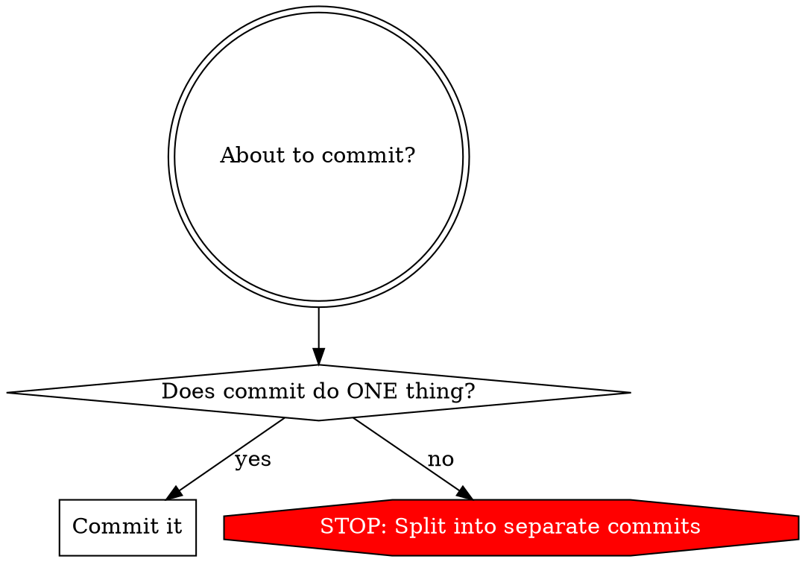

# Writing Commit Messages

## Overview

Every commit message follows a strict format. The subject line completes the sentence: **"If applied, this commit will _\<your subject line\>_"**. The body explains **why**, not what.

## Detect Project Convention First

Before writing a commit, check what style the project already uses:

1. **Check AGENTS.md / CLAUDE.md / GEMINI.md** — if it specifies a commit style, use that
2. **If no config**, check recent history: `git log --oneline -20`
   - If most subjects start with `feat:`, `fix:`, `chore:`, etc. → use Conventional Commits
   - If most subjects use `Fixes #N`, `Closes #N` → include issue references
   - Otherwise → use the plain English imperative style below (the default)

**Project convention always wins.** The rules below are the default when no convention is detected.

## The Format

```
Short (72 chars or less) summary

More detailed explanatory text. Wrap it to 72 characters. The blank
line separating the summary from the body is critical (unless you omit
the body entirely).

Further paragraphs come after blank lines.

- Bullet points are okay, too.
- Use a hyphen followed by a single space. Use a hanging indent.
```

## Quick Reference

| Rule | Example | Violation |
|------|---------|-----------|
| Capitalize subject | `Add CPU arch filter` | `add CPU arch filter` |
| Imperative mood | `Fix null pointer` | `Fixed null pointer` / `Fixes null pointer` |
| No period at end | `Add user auth` | `Add user auth.` |
| 72 char line wrap | Wrap body text | Long unbroken lines |
| Blank line after subject | Subject\n\nBody | Subject\nBody |
| Body explains WHY | "Prevents crash when..." | "Changed X to Y" |

## Subject Line Rules

1. **Capitalize** the first word — always sentence case
2. **Imperative mood** — "Add", "Fix", "Remove", not "Added", "Fixes", "Removing"
3. **72 characters or less** — hard limit
4. **No trailing period**
5. **No scope prefixes** (unless project uses Conventional Commits) — write `Fix null pointer in auth` not `auth: fix null pointer`

### The Imperative Test

Your subject line MUST complete this sentence:

> If applied, this commit will **\_\_\_\_\_\_\_\_\_\_\_\_\_\_\_\_**

- "If applied, this commit will **Add CPU arch filter support**" — correct
- "If applied, this commit will **Fixed a bug**" — wrong (past tense)
- "If applied, this commit will **auth: add login**" — wrong (scope prefix doesn't read as English)

## Body Rules

The body is **optional** for trivial changes (typo fixes, whitespace). When included:

1. **Separate from subject with a blank line** — critical
2. **Wrap at 72 characters** — except for URLs or code that can't be split
3. **Explain WHY, not WHAT** — the diff shows what changed; the message explains why
4. **Capitalize each paragraph**
5. **Describe effects and limitations** — what does this change enable or constrain?

### What Belongs in the Body

- **Why** the change is being made
- **How** it addresses the issue (briefly)
- **What effects** the change has
- **What limitations** exist in the current approach
- Do NOT assume the reviewer understands the original problem
- Do NOT assume the code is self-documenting

### Long URLs in Body

Put URLs on their own line or use references:

```
Implement the technique described at [1] to handle
concurrent connections without thread exhaustion.

[1] https://example.com/very/long/url/that/exceeds/72/chars
```

## Issue References

**Only add issue references if the project already uses them** (detected via `git log --oneline -20`). If recent commits don't contain `Fixes #N`, `Closes #N`, or similar patterns, don't introduce them.

When the project does use issue references:
- Put them in the **body**, not the subject line, on their **own line** at the end
- Subject lines should be meaningful standalone — issue numbers are meaningless outside the hosting platform

```
Add CPU arch filter scheduler support

In a mixed environment of x86 and ARM nodes, the scheduler
could not distinguish architectures, causing binary
incompatibility crashes. Add arch labels to nodes and a
corresponding filter to the scheduling algorithm.

Fixes #847
```

## Atomic Commits



Each commit does **one logical thing**. If your subject line contains "and", you probably need two commits.

**When asked to commit mixed changes, ALWAYS recommend splitting:**
- Refactoring → one commit
- Bug fix → one commit
- New feature → one commit
- Dependency updates → one commit

Do NOT rationalize bundling unrelated changes because:
- "It's faster" — atomic commits are faster to review, revert, and bisect
- "They're all small" — small unrelated changes are easy to split
- "End of day" — time pressure is not a reason to violate commit hygiene

## Example

```
Add CPU arch filter scheduler support

In a mixed environment of x86 and ARM nodes, the scheduler
previously could not distinguish between architectures,
leading to binary incompatibility crashes.

Add an arch label to each node and a corresponding filter
in the scheduling algorithm. This enables workloads to be
scheduled only on compatible architectures.

Current limitation: only x86 and ARM are supported. Adding
new architectures requires updating the label enum.
```

## Conventional Commits Compatibility

The default style is **plain English imperative**, NOT Conventional Commits (`feat:`, `fix:`, etc.). However, if the project uses Conventional Commits (detected via AGENTS.md/CLAUDE.md or `git log --oneline -20`), follow that convention instead. When using Conventional Commits, all other rules still apply (imperative mood, 72-char wrap, body explains WHY, atomic commits).

## Red Flags — Fix Before Committing

- Subject starts with lowercase letter
- Subject uses past tense ("Fixed", "Added") or present participle ("Fixing", "Adding")
- Subject has a scope prefix like `feat:`, `fix:`, `auth:` (unless project uses Conventional Commits)
- Subject ends with a period
- Subject exceeds 72 characters
- No blank line between subject and body
- Body only restates WHAT changed without explaining WHY
- Commit bundles unrelated changes
- Issue reference in subject line instead of body (when project uses them)

## Common Mistakes

| Mistake | Why It's Wrong | Fix |
|---------|---------------|-----|
| `fix: handle null token` | Scope prefix (unless project convention), lowercase | `Handle null session token` |
| `Fixed the auth bug` | Past tense | `Fix null pointer in session validation` |
| `Update stuff` | Vague, no context | `Add expiration check to session tokens` |
| `Refactor DB pool and add prefs endpoint` | Two unrelated changes | Split into two commits |
| Body says "Changed X to Y" | Describes WHAT not WHY | "X caused crashes when Y, so..." |

## Attribution

**Author:** Andrew Fontaine ([@abfontaine](https://gitlab.com/abfontaine))

This skill is based on widely-accepted git commit message conventions, with inspiration from:

- [Commit Message Guidelines](https://gist.github.com/robertpainsi/b632364184e70900af4ab688decf6f53) by Robert Painsi
- [OpenStack GitCommitMessages](https://wiki.openstack.org/wiki/GitCommitMessages)
- [A Note About Git Commit Messages](http://tbaggery.com/2008/04/19/a-note-about-git-commit-messages.html) by Tim Pope
- [How to Write a Git Commit Message](http://chris.beams.io/posts/git-commit/) by Chris Beams
